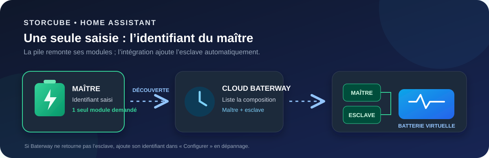
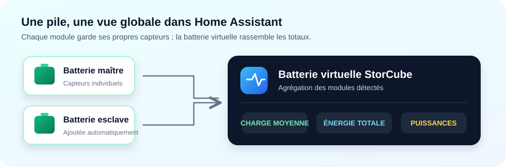

# StorCube Batteries pour Home Assistant

### Plusieurs modules. Une batterie virtuelle. Une seule configuration.

Une intégration communautaire indépendante pour suivre une pile de batteries StorCube dans Home Assistant. Elle récupère les mesures du cloud Baterway, crée un appareil par module détecté et calcule des capteurs agrégés pour la pile.

> **À saisir : uniquement l’identifiant de la batterie maître.** L’intégration demande à Baterway la liste des modules de la pile et découvre la batterie esclave automatiquement. Ne saisis pas l’identifiant de l’esclave dans le champ initial.

## Comment ça marche ?

1. Tu renseignes l’identifiant du **maître** et les identifiants de ton compte StorCube.
2. L’intégration lit la composition de la pile dans Baterway et ajoute les modules trouvés à l’abonnement temps réel.
3. Home Assistant crée les capteurs du maître, de l’esclave détecté et de la **Batterie virtuelle StorCube**.

La découverte automatique dépend de la liste de modules retournée par le compte Baterway. Il faut que l’esclave soit bien associé à la pile dans l’application StorCube. Si l’esclave n’apparaît pas après quelques minutes, la page **Configurer** permet d’ajouter son identifiant manuellement en dépannage.

## Fonctionnalités

- Mesures reçues en direct via le WebSocket Baterway.
- Capteurs individuels pour chaque batterie reconnue : charge, énergie restante, puissances, température, états, firmware et paramètres connus.
- Batterie virtuelle avec charge moyenne, énergie restante cumulée, puissances agrégées et nombre de modules.
- Réglage de la puissance de sortie et du seuil de décharge/réserve depuis Home Assistant.
- Compteurs cumulés en kWh pour les énergies chargée, déchargée, solaire (MPPT 1, MPPT 2 et total) et envoyée vers l’onduleur.
- Diagnostics téléchargeables pour aider à identifier les champs renvoyés par Baterway.
- Les champs inconnus ne sont pas transformés en capteurs ordinaires.

La puissance et l’énergie totales utilisent les totaux de la pile lorsqu’ils sont fournis par l’API. Sinon, l’intégration additionne les modules. La charge de la batterie virtuelle est la moyenne des modules disponibles.

## Installation

### Home Assistant 2026.11 et versions ultérieures

Le dépôt doit être public et publié au Marketplace Home Assistant. Une fois le dépôt ajouté au catalogue, installe **StorCube Batteries (indépendant)** depuis le Marketplace.

### Versions précédentes avec HACS

Dans HACS, ajoute le dépôt comme dépôt personnalisé de type **Intégration**, puis installe l’intégration et redémarre Home Assistant.

### Installation manuelle

1. Copie le dossier `custom_components/storcube_independent` dans le dossier `config/custom_components/` de Home Assistant.
2. Redémarre Home Assistant.
3. Va dans **Paramètres → Appareils et services → Ajouter une intégration**.
4. Recherche **StorCube Batteries (indépendant)**.

## Configuration

Dans le formulaire de configuration, saisis :

| Champ | Valeur |
| --- | --- |
| Identifiants des batteries | **L’identifiant du maître uniquement** |
| Identifiant du compte | Ton identifiant de connexion à l’application StorCube |
| Mot de passe | Le mot de passe de ton compte |
| Code application | `Storcube`, sauf si ton compte utilise un autre code Baterway |

Laisse l’esclave hors du champ initial : il est découvert via la composition de la pile fournie par Baterway. Après la configuration, attends une ou deux minutes que le premier relevé arrive. Tu devrais voir les appareils **Batterie StorCube [identifiant]** et **Batterie virtuelle StorCube**.

Pour vérifier la découverte : ouvre l’appareil **StorCube** dans **Paramètres → Appareils et services → Appareils** et regarde si les deux modules sont présents. Si l’esclave manque, vérifie son association dans l’application StorCube, puis utilise **Configurer** pour ajouter manuellement son identifiant en dépannage.

## Tableau Énergie

Dans **Paramètres → Tableaux de bord → Énergie → Batteries**, sélectionne sur la batterie virtuelle :

- **Énergie déchargée de la batterie** pour l’énergie fournie à la maison ;
- **Énergie chargée dans la batterie** pour l’énergie reçue.

Les deux capteurs sont des compteurs cumulés en kWh. La charge (%) et l’énergie restante (Wh) servent de mesures de la batterie. Home Assistant demande des capteurs d’énergie avec une classe d’appareil énergie et un état cumulatif pour son tableau de bord [Énergie](https://www.home-assistant.io/docs/energy/faq/).

## Dépannage

### L’esclave n’apparaît pas

1. Confirme que le maître et l’esclave sont associés dans l’application StorCube.
2. Vérifie que l’intégration a été configurée avec l’identifiant du maître.
3. Attends quelques minutes : la composition de pile est interrogée périodiquement et l’abonnement temps réel est ensuite actualisé.
4. Si l’esclave reste absent, ouvre **Configurer** sur l’intégration et ajoute son identifiant manuellement. Télécharge les diagnostics si tu veux examiner les trames reçues.

### Les capteurs sont indisponibles

Les capteurs restent indisponibles jusqu’à la première trame de mesure. Vérifie la connexion Internet, les identifiants du compte et les journaux de `custom_components.storcube_independent`.

## Confidentialité et limites

La connexion utilise les points d’accès cloud privés de Baterway. Le format et certains champs peuvent varier selon le modèle ou le firmware. Ne partage jamais ton mot de passe, un jeton d’accès ou un diagnostic sans vérifier qu’il est expurgé.

Ce projet est communautaire, indépendant et sans affiliation avec StorCube. Le code de connexion s’appuie sur l’observation publique du protocole utilisée par `fwPunsher/batteryMqtt` ; l’intégration Home Assistant est écrite séparément.

## Publication

Les instructions pour envoyer ce dépôt sur GitHub et publier une release sont dans [PUBLICATION.md](PUBLICATION.md).
